# Product Viewer Web

<p align="center">
  <strong>An interactive 3D collection of four concept products for the browser: React, TypeScript and
  three.js on WebGPU, with an automatic WebGL2 fallback.</strong>
</p>

<p align="center">
  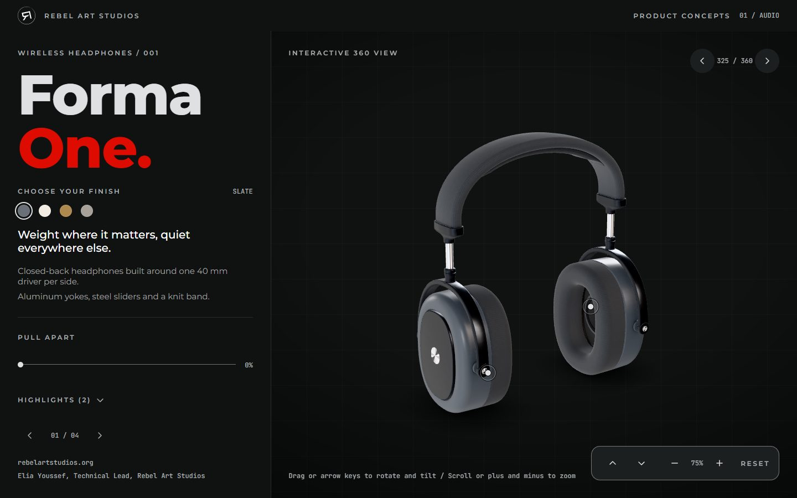
</p>

Product Viewer Web is a small showroom of invented products, each with its own brand. Turn a product around,
zoom in, switch its finish, open the cards that explain its parts, and pull it apart into an exploded view
that shows how it is built. It works with a mouse, a keyboard or a finger, on a desktop or a phone. A live
link will follow.

The engineering constraint is the interesting part. A product is one Blender export and one manifest file,
and nothing else in the code knows which products exist. The same scene renders on WebGPU and on the WebGL2
fallback with the same look, and every scene change goes through one settle step, so a frame never shows a
half-built material.

Visitors can start with the [visual showcase](#visual-showcase); developers with the
[architecture](#architecture) and [getting started](#getting-started).

## Highlights

**The experience**

- Four products, each with its own brand, finishes, cards and exploded view
- Rotate, tilt and zoom with a drag, the arrow keys, the scroll wheel or the on-screen controls
- Hotspot cards that fly the camera to a close-up of the part they describe
- An authored exploded view with a scrub slider, so the product comes apart the way it was designed
- On a phone the card docks in a sheet, and every card is also reachable from the Highlights list
- Full keyboard use, screen reader announcements for products, finishes, cards and camera limits, and a
  reduced motion mode

**The build**

- Data driven: a product is one `.glb` and one manifest, with no product-specific code anywhere else
- `WebGPURenderer` from `three/webgpu`, with custom shading written in TSL and no GLSL anywhere
- Models authored and baked in Blender, compressed with Meshopt geometry and KTX2 textures
- Every model is validated against its manifest and its budgets before it can ship
- Import layers enforced by lint, so the renderer, the store and the UI cannot reach into each other
- Tested in Chrome, Edge, Firefox and WebKit, each on its automatic backend and on forced WebGL2

## Visual showcase

### The collection

<table>
  <tr>
    <td width="33%">
      <a href=".github/readme/orsa-kvern.jpg">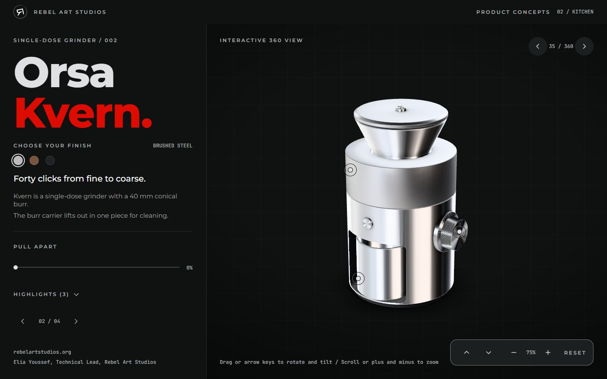</a>
    </td>
    <td width="33%">
      <a href=".github/readme/vidde-spak.jpg">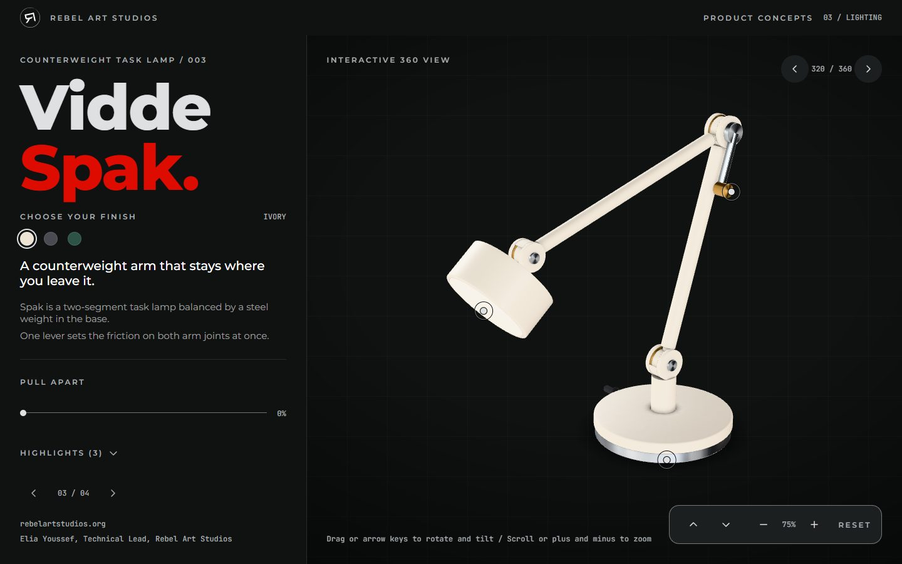</a>
    </td>
    <td width="33%">
      <a href=".github/readme/fjor-tast.jpg">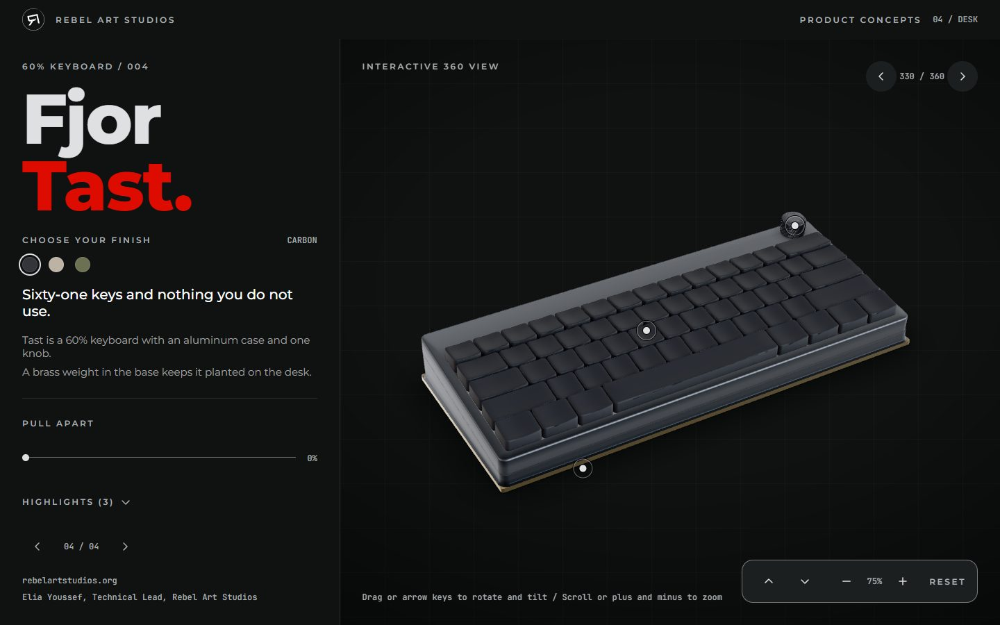</a>
    </td>
  </tr>
  <tr>
    <td align="center">Orsa Kvern, grinder</td>
    <td align="center">Vidde Spak, task lamp</td>
    <td align="center">Fjor Tast, keyboard</td>
  </tr>
</table>

### Explore a product

<table>
  <tr>
    <td width="33%">
      <a href=".github/readme/hotspot-card.jpg">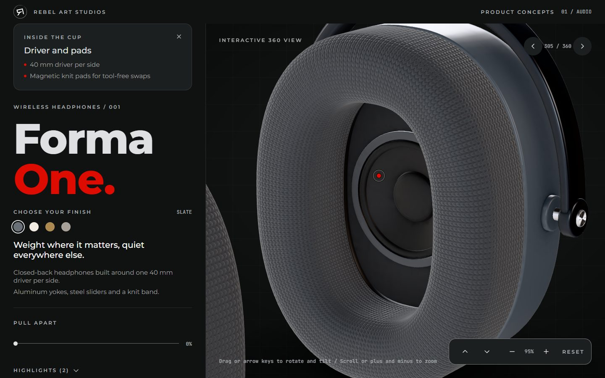</a>
    </td>
    <td width="33%">
      <a href=".github/readme/pull-apart.jpg">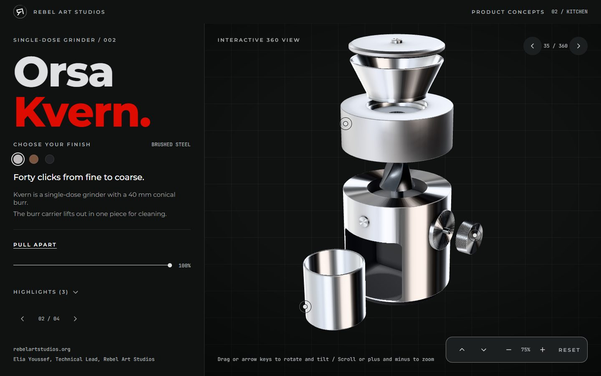</a>
    </td>
    <td width="33%">
      <a href=".github/readme/finishes.jpg">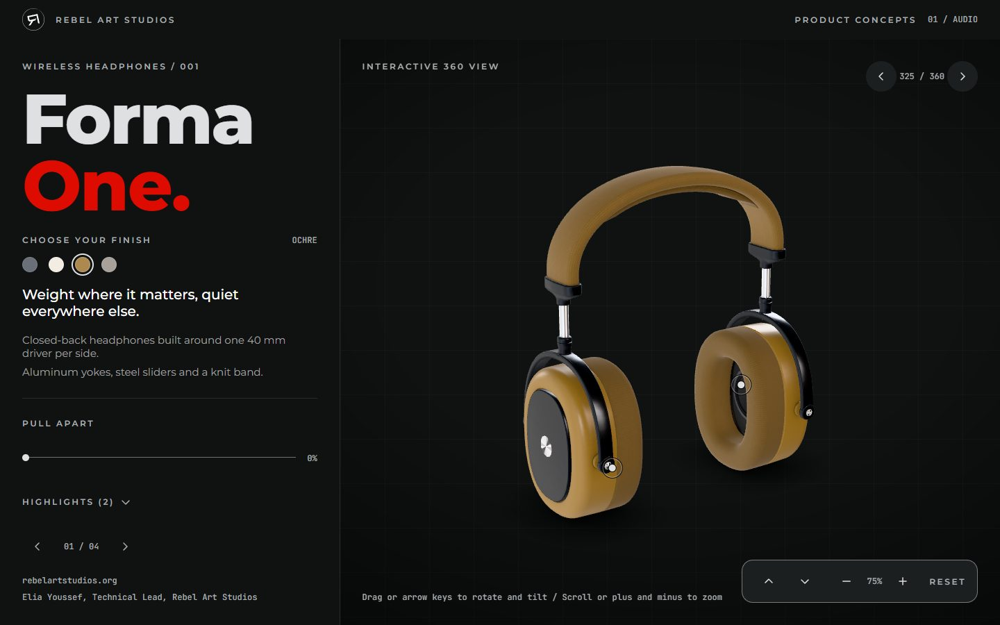</a>
    </td>
  </tr>
  <tr>
    <td align="center">A card and its close-up</td>
    <td align="center">Pulled apart</td>
    <td align="center">Another finish</td>
  </tr>
</table>

### On a phone

<table>
  <tr>
    <td width="33%">
      <a href=".github/readme/phone-home.jpg">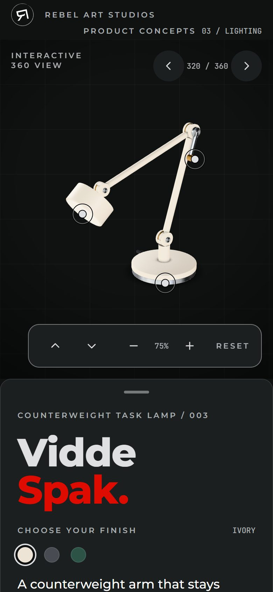</a>
    </td>
    <td width="33%">
      <a href=".github/readme/phone-card.jpg">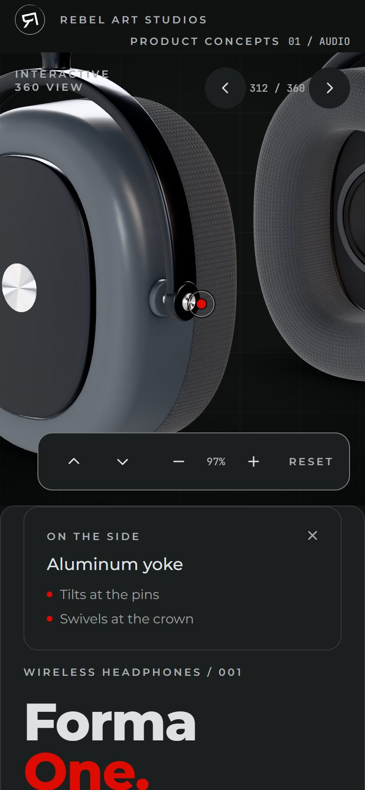</a>
    </td>
    <td width="33%">
      <a href=".github/readme/phone-highlights.jpg">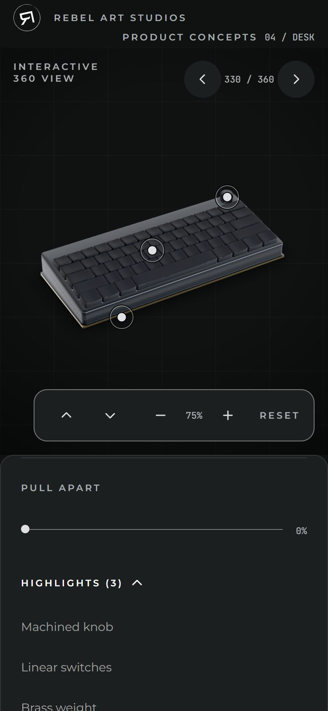</a>
    </td>
  </tr>
  <tr>
    <td align="center">The stage</td>
    <td align="center">A docked card</td>
    <td align="center">The Highlights list</td>
  </tr>
</table>

## The collection

| Product    | Category | What it is              |
| ---------- | -------- | ----------------------- |
| Forma One  | Audio    | Wireless headphones     |
| Orsa Kvern | Kitchen  | Single-dose grinder     |
| Vidde Spak | Lighting | Counterweight task lamp |
| Fjor Tast  | Desk     | 60% keyboard            |

All four are concept products. The brands, names and copy are invented.

## Architecture

### From Blender to the browser

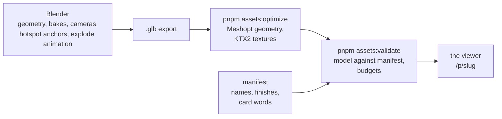

**The model owns geometry, positions and motion; the manifest owns words.** Parts that move apart are
`PART_` nodes, hotspot anchors are `HS_` nodes, the camera views are `CAM_` nodes and the exploded view is an
animation baked into the `.glb`. The manifest holds the brand, the finishes and the title and bullets of each
card. The validate step checks the two against each other and against the budgets: at most 4 MiB per model,
2048 px per texture and 50 draw calls.

### The app

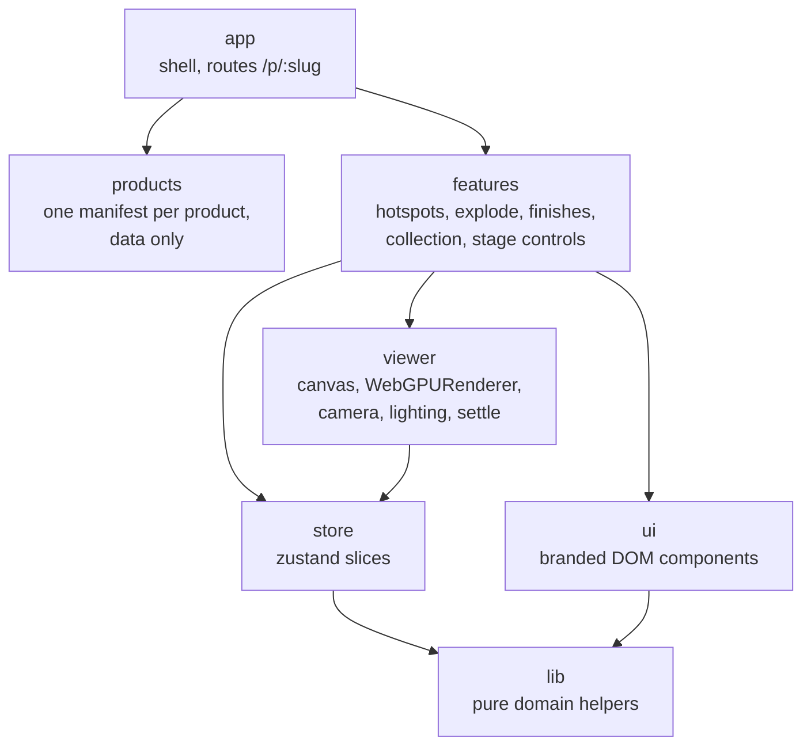

**Imports only flow downward.** The table lives in `tooling/layers.ts` and `pnpm lint` fails on any import
that breaks it: `lib` sees no React and no three.js, `ui` never imports three.js, and features reach each
other only through their `index.ts`.

**One renderer, two backends.** The stage uses the `WebGPURenderer`, and three.js falls back to WebGL2 where
the browser has no WebGPU. Custom shading is written once in TSL, three's node language, so both backends
build it. Add `?backend=webgl` to any address to force the fallback.

**Frames on demand.** The canvas renders only when something changes. Every scene change goes through the
stage's settle step, which waits for the new pipelines before a frame is presented, and the chrome around the
stage is plain DOM, so every control works with a keyboard and a screen reader.

## Technology

- Vite, React and TypeScript
- React Three Fiber on three.js, `WebGPURenderer` with the automatic WebGL2 fallback
- camera-controls for the orbit camera
- TSL for custom shading
- zustand for state, zod for validating manifests
- Blender, gltf-transform (Meshopt, KTX2) for the assets
- Vitest for unit tests, Playwright for end-to-end tests

## Project structure

```
src/
  app/        shell, routes (/p/:slug), page layout
  viewer/     canvas, renderer setup, camera controls, lighting, model loading
  features/   hotspots, explode, variants (finishes), collection, product panel,
              stage controls, load readout
  ui/         shared branded components
  store/      zustand store, composed from feature slices
  products/   one manifest per product and the collection index
  styles/     tokens, fonts, global CSS
  lib/        pure helpers and domain types
public/       shipped static files: models, environment map, fonts, brand marks, social cards
assets/       Blender pipeline settings (raw exports and sources stay out of git)
scripts/      asset pipeline and build steps, run by plain Node
tooling/      lint, format and architecture gates
tests/e2e/    Playwright specs and the browser matrix
```

## Getting started

**Prerequisites.** Node.js 24.14.0 or newer and pnpm 10.32.1 (Corepack picks it up from `package.json`).

```sh
pnpm install
pnpm dev
```

The dev server listens on port 5290; set `VIEWER_PORT` to use another port from 5290 to 5299.

**Build and preview the production bundle.**

```sh
pnpm build
pnpm preview
```

`pnpm build` bundles the app, prerenders a page per product for link previews and checks the output in
`dist/`, which any static host can serve.

**Add a product.** Put the model at `public/models/<slug>/model.glb`, add
`src/products/<slug>.manifest.ts`, then run `pnpm assets:validate <slug>`. The collection index, the route and
the navigation pick it up with no other change.

## Verification

```sh
pnpm check
```

`pnpm check` runs every gate below in order.

| Gate                   | What it proves                                                           | Current                       |
| ---------------------- | ------------------------------------------------------------------------ | ----------------------------- |
| `pnpm typecheck`       | Strict TypeScript across the app, the tests and the tooling              | Clean                         |
| `pnpm lint`            | ESLint, the import layers and the repository rules                       | Clean                         |
| `pnpm format:check`    | Every authored file in the project style                                 | Clean                         |
| `pnpm test`            | Unit tests                                                               | 3,085 tests in 336 files      |
| `pnpm assets:validate` | Every model against its manifest and the budgets                         | 4 products, no violations     |
| `pnpm build`           | The bundle, the prerendered product pages and the deploy check           | Clean                         |
| `pnpm e2e`             | Chrome, Edge, Firefox and WebKit, on the automatic backend and on WebGL2 | 11,290 tests in the full tier |

The default tier runs the whole suite on Chrome (WebGPU and WebGL2), Firefox and WebKit, and the launch and
routing smoke specs on the other four projects. `VIEWER_E2E_TIER=full pnpm e2e` runs every spec on every
browser and every product.

## Repository scope

This repository is the complete site: source, shipped models, tests and tooling. A fresh clone builds and runs
it with `pnpm install` and `pnpm dev`. The Blender sources and raw exports, and the design and planning
documents, are kept outside this repository, so `pnpm assets:optimize` needs a local export to rebuild a model.

## Credits

Elia Youssef, Technical Lead, Rebel Art Studios

- Website: [rebelartstudios.org](https://rebelartstudios.org/)
- LinkedIn: [Elia Youssef](https://www.linkedin.com/in/elia-youssef/)

Fonts are Montserrat and JetBrains Mono, both under the SIL Open Font License (the license texts are in
`public/fonts`).

## Licensing

No open-source license is included. Unless a separate written agreement grants permission, the source is
provided for viewing and reference only.
